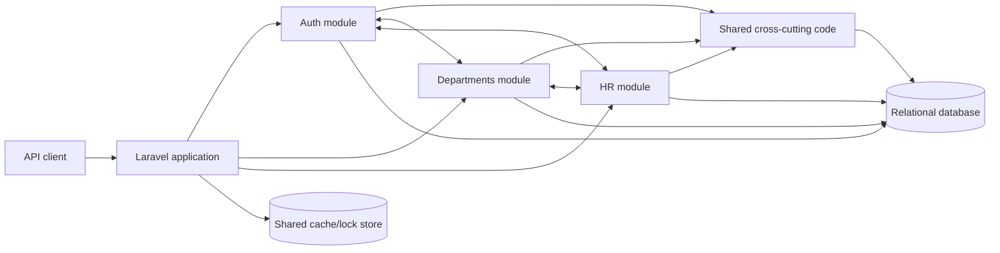
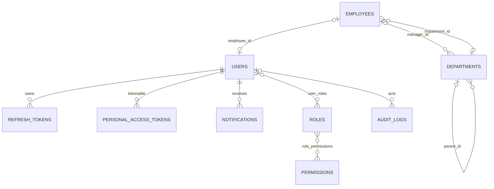

# Alraqi ERP System — Architecture and Maintainer Guide

Evidence snapshot: 2026-07-19  
Audience: senior engineers onboarding to ownership  
Scope: the code, configuration, migrations, tests, and documentation currently in this repository

## 1. How to read this guide

Every substantive conclusion uses one of these evidence labels:

- **Observed** — directly visible in code, configuration, migrations, documentation, registered Laravel metadata, or passing tests.
- **Inferred** — a likely design intention or consequence. The supporting evidence and reasoning are stated.
- **Unknown** — the repository does not contain enough evidence to answer safely.
- **Recommendation** — a proposed future change, not a description of the current system.

Runtime verification for this snapshot:

- **Observed:** `php artisan route:list -v` registered 33 routes: 27 domain API routes plus the default `/api/user`, web root, health, Sanctum CSRF, and local-storage routes.
- **Observed:** `auth:prune-refresh-tokens` is registered and scheduled daily.
- **Observed:** `php artisan test` passed **116 tests / 405 assertions**.
- **Observed:** no production deployment was exercised. Passing tests prove the test configuration, not production readiness.

The older [`PROJECT_ARCHITECTURE_REPORT.md`](PROJECT_ARCHITECTURE_REPORT.md) contains a historical 2026-06-18 snapshot followed by a 2026-06-21 status section. It is useful history but has superseded statements. This guide describes the current tree.

## 2. Executive mental model

### 2.1 What the system is

**Observed:** this is a PHP 8.2 / Laravel 12 backend for the first phase of a modular ERP. The implemented business surface is:

1. identity and token authentication;
2. users, roles, permissions, and route-level RBAC;
3. a three-tier organizational department hierarchy;
4. employee records linked to departments and optionally to login accounts;
5. stored, per-user notifications with user/department/role fan-out;
6. request-, action-, and model-level auditing.

Evidence: [`composer.json`](../composer.json), [`app/Modules`](../app/Modules), module route files, migrations, and feature tests.

**Inferred:** “ERP” currently describes the architectural direction more than product breadth. The evidence is that Auth, Departments, and a small HR employee slice exist, while finance, inventory, procurement, payroll, and accounting code do not.

**Unknown:** the exact organization, commercial product requirements, expected tenant model, user count, traffic profile, regulatory regime, and production topology are not present in the repository.

### 2.2 Architectural style

**Observed:** the application is a **modular monolith** with a **layered structure inside each module**. It is one Laravel process, one dependency container, and one relational schema. Modules are code boundaries, not independently deployed services.



The bidirectional module arrows are intentional: current domain relationships cross boundaries. `User` references `Employee`; `Employee` references `Department`; `Department` references `Employee` as manager; notification fan-out reads all three modules. Therefore these are organizational boundaries, not strict dependency-isolated bounded contexts.

### 2.3 The normal request path

**Observed:** most domain requests follow this path:

```mermaid
flowchart LR
    R["Route"] --> A["auth:sanctum"]
    A --> U["permission middleware"]
    U --> V["FormRequest validation"]
    V --> C["Thin controller"]
    C --> S["Service"]
    S --> M["Eloquent model / DB"]
    M --> X["JSON Resource"]
    X --> E["ApiRespond envelope"]
    E --> L["audit middleware"]
```



Not every route uses every box. Login and refresh are public and throttled. Notification reads use authentication and ownership scoping but no permission or audit middleware. `/api/user` is default scaffold code and returns a raw user rather than the project envelope.

### Key takeaways

- Think “one Laravel system divided by business area,” not microservices.
- Controllers translate HTTP; services make decisions; models and migrations enforce persistence behavior.
- Auth is both an authentication module and the identity/RBAC foundation used by the other modules.

### Things to remember

- A user name lives on the linked employee, not on `users`.
- Department hierarchy rules are enforced below HTTP as well as in validation.
- Stored notifications are custom rows; Laravel's stock database-notification channel is not compatible.

### Common sources of confusion

- Folder boundaries look stronger than the actual dependency boundaries.
- Comments mentioning “future” RBAC in `CheckPermission` are stale; RBAC is implemented and fail-closed.
- The default README describes Laravel, not this system.

### Related components

[`ModuleServiceProvider.php`](../app/Providers/ModuleServiceProvider.php), [`bootstrap/app.php`](../bootstrap/app.php), [`API_DOCUMENTATION.md`](API_DOCUMENTATION.md), and [`erp-phase1-architecture.md`](erp-phase1-architecture.md).

## 3. Bootstrapping, structure, and dependency direction

### 3.1 Startup

**Observed:** HTTP enters through [`public/index.php`](../public/index.php). [`bootstrap/app.php`](../bootstrap/app.php) registers web, API, console, and `/up` health routes; aliases `audit` and `permission`; and centrally renders the custom authentication exception family as JSON.

**Observed:** [`bootstrap/providers.php`](../bootstrap/providers.php) registers `AppServiceProvider` and `ModuleServiceProvider`.

- [`AppServiceProvider.php`](../app/Providers/AppServiceProvider.php) installs a super-admin `Gate::before` bypass and rate limiters of 5 login attempts/minute/IP and 10 refresh attempts/minute/IP.
- [`ModuleServiceProvider.php`](../app/Providers/ModuleServiceProvider.php) scans immediate folders under `app/Modules`. A `{Module}/routes.php` file is mounted at `/api/{lowercase-module}` with Laravel's `api` middleware group. Every subdirectory under `database/migrations` is registered as a migration path.

**Observed:** services are concrete classes resolved by Laravel constructor injection. There are no repository interfaces, service interfaces, or custom bindings in `ModuleServiceProvider::register()`.

### 3.2 Repository map

```text
app/
  Modules/
    Auth/          identity, tokens, RBAC, notifications
    Departments/   organizational tree and invariants
    HR/            employee records
  Shared/          API envelopes, audit service/trait, middleware
  Providers/       module discovery, gates, rate limits
  Console/Commands refresh-token cleanup
database/
  migrations/{Auth,Departments,HR,Shared}/
  seeders/         permissions, roles, initial user/data wiring
routes/            framework-level web/API/console routes
tests/Feature/     end-to-end HTTP/domain behavior
docs/              API, decisions, audits, and this guide
postman/           importable collection and environment
resources/         default Blade/Vite/Tailwind scaffold
config/            Laravel runtime configuration
```

### 3.3 Dependency rules visible in practice

**Observed:** route → request/controller → service → Eloquent/resource is the dominant direction.

**Observed:** `Shared` depends on Laravel abstractions and is consumed by every module. `Auth`, `Departments`, and `HR` also directly import each other's models. There is no domain event or anti-corruption layer between them.

**Inferred trade-off:** direct model references keep phase-one development simple and make transactions/relationships easy, but make module extraction harder. Evidence: the circular `users.employee_id`, `employees.department_id`, and `departments.manager_id` schema and imports.

### Key takeaways

- Adding a module folder and `routes.php` is enough for route discovery; adding a migration subfolder is enough for migration discovery.
- Module auto-discovery is convention-based. A folder rename changes its URL prefix.
- Shared code should remain domain-neutral; current cross-domain orchestration is concentrated mainly in `NotificationService`.

### Things to remember

- Migration ordering matters across folders; timestamps resolve the Department ↔ Employee foreign-key cycle.
- `routes/api.php` still exposes default `/api/user`; normal domain routes live in module route files.

### Common sources of confusion

- A new module needs no provider edit, but it still needs namespaces, routes, migrations, permissions, seed data, and tests.
- Concrete service injection is deliberate current simplicity, not evidence of ports-and-adapters architecture.

### Related components

[`composer.json`](../composer.json), [`package.json`](../package.json), [`routes/console.php`](../routes/console.php), and [`phpunit.xml`](../phpunit.xml).

## 4. Component guide

### 4.1 Auth module

| Component | Observed responsibility | Dependencies / consumers | Lifecycle and extension point |
|---|---|---|---|
| `AuthController` | Login, refresh, logout, current-user HTTP translation | `AuthService`, `AuthResource`, `ApiRespond` | Add authentication endpoints here only when they use the same identity lifecycle; larger features merit a dedicated service/controller. |
| `AuthService` | Credential checks, access/refresh issuance, refresh rotation, replay response, logout/revocation | `User`, `RefreshToken`, Sanctum, DB transactions, `AuditLogService` | Central owner of tokens. Preserve row locking and out-of-transaction replay revocation. |
| `UserController` / `UserService` | Admin user CRUD | Employee link, audit service | Role mutation intentionally stays in `RoleService`. |
| `RoleController` / `RoleService` | Role CRUD, permission sync, assignment/unassignment | `Role`, `Permission`, `User`, `PermissionCache` | Every RBAC write must flush the permission cache. System roles are immutable through this service. |
| `NotificationController` / `NotificationService` | Owner-scoped reads; snapshot fan-out to user, department subtree, or role | User, Role, Department, Employee relationships | All stored-notification creation must go through `sendTo*`; physical delivery is not implemented. |
| `PermissionCache` | Versioned, one-hour cached effective permission sets | configured Laravel cache store | Any new direct RBAC mutation must call `flush()`. A shared store is required across workers. |
| Models/resources/requests | Persistence relationships, validation, output transformation | Eloquent and Laravel resources | `UserResource`/`AuthResource` are the public identity shape; avoid returning raw models. |

### 4.2 Departments module

| Component | Observed responsibility | Why it exists / change impact |
|---|---|---|
| `DepartmentLevel` | Registry of valid levels: General Administration=1, Division=2, Section=3 | An integer column plus enum allows a new tier without a SQL enum migration. Adding a tier changes valid tree depth globally. |
| `DepartmentHierarchyGuard` | Defined level, one root, exact parent/child tier, no self-parent, no cycles | Single owner prevents HTTP and non-HTTP writers from diverging. |
| `Department` model hooks | Re-run hierarchy guard on every save; prevent root deletion and soft-deleting a node with live children | Protects seeders, jobs, Tinker, and services—not just API calls. |
| `DepartmentRequest` family | Field validation and friendly 422 mapping of guard violations | Partial update computes the effective final parent/level before checking. |
| `DepartmentService` | Pagination/CRUD plus root cache lock and parent row locks | Closes create/delete races when using a shared lock store and a DB with real row locks. |
| Controller/resource/exceptions | HTTP translation, JSON shape, domain errors | Hierarchy failures render as 422; deleting root/parent with children renders as 409. |

### 4.3 HR module

| Component | Observed responsibility | Why it exists / change impact |
|---|---|---|
| `Employee` | Employee profile, soft delete, audit, department/user relations, generated employee number | It is the source of a user's display name. Renaming an employee changes the displayed user name. |
| `EmployeeRequest` | Create/update validation, live-department constraint, status and uniqueness rules | Create requires `name`; other fields are optional. Salary must be non-negative. |
| `EmployeeService` | Paginated CRUD and eager loading of department | Deliberately thin; domain workflows such as hiring/payroll do not exist. |
| Controller/resource | HTTP and public JSON shape | CRUD routes are separately permissioned. |

### 4.4 Shared and framework components

- **Observed — `ApiRespond`:** success/error envelope and explicit pagination metadata. It is composition through a trait, not a base-controller hierarchy.
- **Observed — `AuditLogService`:** the sole audit-row formatter; direct table inserts avoid recursive Eloquent events and redact a fixed sensitive-key list.
- **Observed — `HasAuditLog`:** attaches created/updated/deleted hooks to `User`, `Role`, `Department`, and `Employee`; audit failures are reported but do not abort the business write.
- **Observed — `AuditLogMiddleware`:** records authenticated request method, path, status, and route name after the downstream handler returns. It is synchronous before the HTTP response is returned from middleware; despite its comment, it is not a terminable/queued “after response” job.
- **Observed — `CheckPermission`:** returns 401 without a user, 403 without the named capability, and otherwise continues. It has no fail-open branch.
- **Observed — `PruneExpiredRefreshTokens`:** removes old expired/revoked refresh-token rows according to a retention window and runs daily.

### Key takeaways

- The most important invariants live in `AuthService`, `PermissionCache`, model hooks, and `DepartmentHierarchyGuard`—not in controllers.
- Services are the safe reuse boundary for jobs/commands and other modules.
- Resources define the API contract; model fillable/casts define persistence behavior, not public output.

### Things to remember

- `Notifiable` remains on `User`, but its `notifications()` relation is shadowed by the custom relation. Do not call `$user->notify()` for database delivery.
- Audit is deliberately fail-open. This favors availability over compliance-grade guaranteed audit capture.

### Common sources of confusion

- Employee “delete” and Department “delete” are soft deletes.
- User delete is a hard delete and cascades roles, tokens, and notifications.
- System-role protection is application-level; direct DB writes can bypass it.

### Related components

[`app/Modules/Auth`](../app/Modules/Auth), [`app/Modules/Departments`](../app/Modules/Departments), [`app/Modules/HR`](../app/Modules/HR), and [`app/Shared`](../app/Shared).

## 5. Significant execution flows

### 5.1 Login and token use

```mermaid
sequenceDiagram
    participant C as Client
    participant R as Route + LoginRequest
    participant A as AuthService
    participant DB as Database / Sanctum
    participant Audit as AuditLogService
    C->>R: POST /api/auth/login
    R->>R: throttle 5/min/IP; validate email/password
    R->>A: login(email, password)
    A->>DB: find user; verify password and is_active
    A->>DB: transaction: delete old access tokens
    A->>DB: create 15-minute Sanctum token
    A->>DB: create hashed 30-day refresh token
    A->>DB: update last_login_at quietly
    A->>Audit: user_logged_in
    A-->>C: user + access token + refresh token
```

**Observed:** bad email and bad password share a generic 401. Disabled accounts return 403. Access tokens have `*` ability and expire after 15 minutes. Refresh tokens are 64 random characters, SHA-256 hashed at rest, and expire after 30 days.

**Observed:** issuing an access token deletes all existing Sanctum access tokens for that user. Login does not revoke older refresh tokens. Logout revokes all access and active refresh tokens, so logout is “all sessions,” not “this device.”

**Inferred consequence:** the access side behaves as one active access token per user, while several refresh tokens can remain usable. An older device can refresh later and invalidate the access token held by another device. This is a product/security behavior to preserve or deliberately redesign, not an incidental controller detail.

### 5.2 Refresh rotation and replay

```mermaid
sequenceDiagram
    participant C as Client
    participant A as AuthService
    participant DB as Database
    C->>A: POST /api/auth/refresh with plaintext token
    A->>DB: SHA-256 lookup + SELECT FOR UPDATE
    alt missing / expired / inactive
        A-->>C: 401
    else valid
        A->>DB: revoke old refresh token
        A->>DB: delete old access tokens; issue new pair
        A-->>C: new access + refresh tokens
    else already revoked (replay)
        A->>DB: rollback lookup transaction
        A->>DB: separate transaction revokes all user tokens
        A-->>C: 401
    end
```

The replay response is intentionally outside the failed rotation transaction so the defensive revocation survives the exception. Row locking ensures two simultaneous uses of one token cannot both rotate successfully on a database that supports `FOR UPDATE`.

### 5.3 RBAC decision

1. `auth:sanctum` authenticates the bearer token.
2. `CheckPermission` asks `User::hasPermission(permission-string)`.
3. `PermissionCache` loads a version-stamped cached result.
4. A holder of the `super_admin` role passes every permission and receives the full permission catalogue.
5. A normal user's role permissions are flattened, de-duplicated, and compared strictly.
6. Any role/assignment mutation bumps the global cache version.

**Trade-off:** global versioning makes invalidation simple and correct, but one RBAC edit causes lazy cache misses for every user. For an ERP with infrequent role changes this is reasonable; that workload assumption is **Inferred**, not measured.

### 5.4 Department write

1. Route authenticates and checks an action-specific `departments.*` permission.
2. Form request validates fields and calls the hierarchy guard, returning field-level 422 errors.
3. Service performs the write. Root creation uses a named cache lock; child creation locks the parent row; deletion locks the subject row.
4. The model save hook invokes the same guard again, protecting all writers.
5. Delete hooks forbid root deletion and deletion with live children; otherwise `deleted_at` is set.
6. `HasAuditLog` attempts to record old/new data.

**Inferred limitation:** `DepartmentService::update()` does not use the named root lock or row-lock transaction. Concurrent updates that both try to become the root have a check-then-write window because MySQL cannot express the singleton-live-root rule. Tests prove serial behavior, not this concurrent case.

### 5.5 Employee CRUD

1. Auth and `hr.employees.{action}` permission run.
2. `EmployeeRequest` validates fields; a referenced department must exist and not be soft-deleted.
3. Service creates/updates/deletes the Eloquent model.
4. On create, the model generates `EMP-{next max id, padded to 5}` when the number is absent.
5. List queries eager-load department; resource transforms output; audit hooks attempt to persist changes.

**Inferred limitation:** two concurrent creates can calculate the same next employee number. The unique index prevents duplication but one insert can fail; no retry exists.

### 5.6 Notifications

**Read path:** all queries start from the authenticated user's `notifications()` relationship. A foreign ID therefore produces 404 rather than cross-user access. Mark-read is idempotent.

**Send path:** `sendToUser`, `sendToDepartment`, and `sendToRole` resolve active user IDs at send time and bulk-insert one row per distinct recipient. Department sends walk the live subtree level by level and require a live employee link. Later membership changes do not change old notifications.

**Unknown:** no route currently exposes send operations. They are service extension points for future workflows/jobs. No mail, push, WebSocket, broadcast, or worker-driven transport is implemented.

### Failure and termination summary

- Validation terminates before controllers with Laravel 422 responses.
- Missing route-bound models terminate with 404.
- Authentication errors are centrally rendered; account-disabled is 403 and invalid credentials/refresh is 401.
- Permission failure terminates with 403.
- Domain conflicts such as system-role mutation or illegal department deletion render 409.
- Unhandled database/cache/programming errors use Laravel's global exception behavior; no project-specific universal 500 envelope exists.
- There is no application retry policy for database writes or external calls. Token rotation relies on locking, not retry.

## 6. API surface

**Observed:** the domain API is unversioned. Clients send/receive JSON. Protected routes use `Authorization: Bearer <access-token>`.

| Area | Routes | Guard |
|---|---|---|
| Auth | `POST /api/auth/login`, `POST /api/auth/refresh` | Public; 5/min and 10/min per IP |
| Session | `POST /api/auth/logout`, `GET /api/auth/me` | Sanctum + audit |
| Users | `GET/POST /api/auth/users`, `PUT/PATCH/DELETE /api/auth/users/{user}` | Sanctum + audit + `auth.users.{action}` |
| Roles | list/create/update/delete plus `/assign` and `/unassign` | Sanctum + audit + `auth.roles.{action}` |
| Notifications | list, unread count, `POST /{notification}/read` | Sanctum; owner-scoped; no audit middleware |
| Departments | list/create/show/update/delete | Sanctum + audit + `departments.{action}` |
| Employees | list/create/show/update/delete | Sanctum + audit + `hr.employees.{action}` |

Detailed request/response examples and field rules are maintained in [`API_DOCUMENTATION.md`](API_DOCUMENTATION.md) and the [`postman`](../postman) collection. The implementation sources of truth are each module's `routes.php`, `Requests`, controllers, and `Resources`.

Important contract details:

- Successful project endpoints normally return `{success, message, data}`; paginated endpoints add `meta`.
- Roles and users lists are unpaginated; departments, employees, and notifications are paginated at 15/page.
- Laravel/framework-generated errors are not guaranteed to include the project `success` flag. `/api/user` also returns a raw model.
- No API version prefix, idempotency-key support, ETag/conditional update, or project-level general API rate limit is visible.
- Only login and refresh have named rate limits. No retry instructions or `Retry-After` contract is documented beyond Laravel throttle behavior.

### Key takeaways

- Use route permissions as the server-side authority; UI permission checks are only usability.
- Treat resources and API docs as contracts, but confirm route middleware with `route:list -v` after changes.
- Refresh tokens are supplied in the JSON body, not an httpOnly cookie.

### Things to remember

- 401 means authenticate/refresh; 403 means authenticated but disabled or forbidden.
- Notification ownership replaces permission middleware for those three routes.

### Common sources of confusion

- `DELETE` for departments/employees returns success after soft delete, not physical removal.
- The default `/api/user` is outside the modular contract.

### Related components

[`Auth/routes.php`](../app/Modules/Auth/routes.php), [`Departments/routes.php`](../app/Modules/Departments/routes.php), and [`HR/routes.php`](../app/Modules/HR/routes.php).

## 7. Data model and persistence



### 7.1 Domain tables

- **`users`:** unique email, hashed password cast, active flag/index, optional unique employee FK, login timestamps. Employee deletion nulls the link.
- **`personal_access_tokens`:** Sanctum polymorphic access tokens; unique hash; expiry index.
- **`refresh_tokens`:** user FK/cascade, unique 64-character SHA-256 hash, revoked and expiry indexes, `(user_id, revoked)` index.
- **`roles` / `permissions`:** unique machine names; system-role marker; permission module grouping.
- **`user_roles` / `role_permissions`:** composite primary keys prevent duplicate grants and cascade on parent deletion.
- **`departments`:** self-parent FK restricted on hard delete; unique optional code; integer level; optional manager; active flag; soft delete. Single-root and tier rules are application-enforced.
- **`employees`:** unique number, optional unique national ID, contact/employment/pay data, nullable department FK, status index, soft delete.
- **`notifications`:** one recipient user, first-class title/body/type, optional polymorphic reference, read index, timestamps.
- **`audit_logs`:** nullable actor, event and time indexes, optional polymorphic subject, JSON old/new values, network metadata.

### 7.2 Infrastructure tables

**Observed:** migrations create database cache/locks, sessions, password-reset tokens, jobs, job batches, and failed jobs. Their existence means Laravel infrastructure is available, not that application workflows use it.

**Observed:** there are no application Job classes in the repository. The Composer `dev` script starts a queue listener, but current notification and audit writes are synchronous.

### 7.3 Transactions and consistency

- Auth login, refresh, logout, and broad revocation use DB transactions.
- Role create/update uses transactions; assignment/unassignment are single pivot operations without an explicit transaction.
- User create/update use transactions; delete is a direct model delete followed by audit.
- Department create/delete use transaction/locks; update does not.
- Employee CRUD has no explicit transaction because each operation is a single aggregate-row write plus best-effort audit hooks.
- Audit hooks catch failures. Therefore business data can commit without its audit row.

### 7.4 Database runtime

**Observed:** `.env.example` defaults to SQLite and database-backed cache, queue, and sessions. `phpunit.xml` uses an in-memory SQLite test database. Laravel config also defines MySQL, MariaDB, PostgreSQL, and SQL Server options.

**Unknown:** the production database engine, isolation level, backups, replicas, encryption, retention, and operational ownership are not documented. Comments discuss MySQL behavior, but comments are not deployment evidence.

### Key takeaways

- Schema constraints are the last line of defense; several business invariants necessarily live in application code.
- Soft deletion preserves organizational/employee history; user deletion removes dependent identity artifacts.
- Database cache is not merely a performance setting here: it participates in RBAC correctness and department locking across workers.

### Things to remember

- `is_active` on User controls access; Employee `status` is not consulted by authentication or notification eligibility.
- Department `is_active` does not automatically hide the unit or block employee assignment in current queries/validation.

### Common sources of confusion

- Comments saying employees are “never hard-deleted” describe intended application behavior; Eloquent `forceDelete()` can still be invoked unless foreign keys block it.
- Nullable unique-column behavior can vary by database, although the expected design assumes multiple NULL values are allowed.

### Related components

[`database/migrations`](../database/migrations), [`config/database.php`](../config/database.php), and model classes under each module.

## 8. Design decisions and patterns

| Pattern / decision | Observed use | Benefit | Cost / alternative |
|---|---|---|---|
| Modular monolith | Module folders, auto-loaded routes/migrations | One deploy and transaction boundary with domain-oriented navigation | Cross-module coupling can grow. Alternative: explicit package boundaries or services when independently deployable needs exist. |
| Layered application service | Controllers delegate to services | Testable logic and thin HTTP layer | Some services are CRUD wrappers. Direct controllers would be simpler but less consistent. |
| Active Record | Eloquent models own relations/hooks | Laravel-native, concise persistence | Domain logic can couple to DB/framework. Repository/data-mapper alternative would add abstraction cost. |
| Form Request | Validation at HTTP boundary | Reusable declarative input rules and localized messages | Non-HTTP writers bypass it, hence model/guard invariants remain necessary. |
| Resource transformation | JSON Resources | Stable output independent of raw model attributes | Requires discipline on every endpoint. |
| RBAC | User ↔ Role ↔ Permission | Manageable fine-grained route access | Cache invalidation and administration complexity. Direct per-user grants are absent. |
| Refresh-token rotation | One-use custom tokens + Sanctum access tokens | Short access exposure and replay detection | Stateful refresh store and more client logic. Cookie/session alternative is not implemented. |
| Version-stamped cache | `PermissionCache` | Simple globally correct invalidation | Global re-warm after any change. |
| Model-hook invariant | audit and department hierarchy | Covers every Eloquent writer | Bulk/query-builder writes can bypass hooks. Explicit domain repository is an alternative. |
| Snapshot fan-out | One notification row per recipient | Simple owner reads and stable audience history | Write amplification. Audience-reference storage would reduce writes but change semantics. |
| Soft delete | Department and Employee | Historical referential continuity | Queries must understand live vs trashed records; storage grows. |

No evidence supports event sourcing, CQRS, hexagonal architecture, microservices, sagas, message buses, or distributed transactions.

## 9. Errors, security, and audit

### 9.1 Error strategy

**Observed:** validation, authentication, authorization, route-model binding, and domain exceptions are the main failure categories. Auth exceptions are centralized in `bootstrap/app.php`; several domain exceptions implement their own `render()` methods. Services generally allow unexpected exceptions to propagate to Laravel.

**Observed:** there is no custom global handler that normalizes every API exception. Error envelope consistency is therefore partial.

**Observed:** application-level retry/fallback behavior is absent. Audit failures are the explicit fallback: report and continue.

### 9.2 Security mechanisms present

- bcrypt-backed Laravel `hashed` password cast and generic invalid-login response;
- Sanctum bearer access tokens with 15-minute expiry;
- high-entropy refresh tokens hashed at rest, rotated under row lock;
- replay detection revoking all user tokens;
- account disable flag;
- route-level RBAC with super-admin bypass;
- request validation and Eloquent mass-assignment allowlists;
- login/refresh IP throttling;
- sensitive-key audit redaction;
- DB foreign keys, unique constraints, and transactions.

### 9.3 Security gaps or unknowns

- **Observed:** no MFA, password-reset endpoint, email-verification enforcement, password policy beyond request minimums, login lockout, device/session management UI, or fine-grained token abilities.
- **Observed:** refresh token travels in JSON. Browser storage and CSRF/XSS posture are client responsibilities not solved here.
- **Observed:** audit redaction matches exact key names only; nested or differently named secrets may be logged.
- **Observed:** request audits store path, status, IP, and user-agent but not request bodies. This limits exposure and also limits forensic detail.
- **Unknown:** TLS termination, WAF, CORS policy in the deployed environment, secret rotation, database-at-rest encryption, database privileges, vulnerability scanning, and incident response.
- **Unknown:** whether production grants append-only database permissions on `audit_logs`; the migration comment recommends it but cannot enforce it.

### Key takeaways

- Authentication is materially implemented, not scaffold-only, but it is phase-one token security rather than a complete identity platform.
- Authorization is server-enforced and cache-backed; cache sharing is a correctness requirement.
- Audit is broad but best-effort, so it cannot yet be described as guaranteed compliance logging.

### Things to remember

- Super-admin power comes from role name and bypass logic, not permission rows.
- Direct pivot writes can create stale RBAC cache until TTL unless they flush it.

### Common sources of confusion

- Gate bypass exists, but routes use custom permission middleware rather than policies; both honor super admin through separate paths.
- A 403 can mean disabled account at login or insufficient permission later.

### Related components

[`config/auth.php`](../config/auth.php), [`config/sanctum.php`](../config/sanctum.php), [`PermissionCache.php`](../app/Modules/Auth/Support/PermissionCache.php), and [`AuditLogService.php`](../app/Shared/Services/AuditLogService.php).

## 10. Performance and scalability

### 10.1 Current performance characteristics

- Eager loading avoids obvious N+1s in user, role, and employee lists.
- Permission checks are cached for one hour with explicit invalidation.
- Refresh lookup, revocation, audit queries, statuses, hierarchy traversal, and unread state have supporting indexes.
- Department subtree fan-out performs one query per depth tier plus recipient lookup and one bulk insert. Current depth is bounded at three.
- Notification read and domain list endpoints paginate; user and role lists load the full collection.
- Audit writes are synchronous direct inserts. Protected mutating requests can create both model/action audit rows and a request audit row.
- `HasAuditLog` serializes changed attributes to JSON; large/frequent models would increase write/storage cost.

### 10.2 Scaling model

**Inferred:** stateless bearer authentication permits multiple web workers, but correctness requires all workers to share the primary database and cache/lock store. Evidence: token rows, permission version keys, and department named locks.

Likely first bottlenecks, based on code rather than measurement:

1. unbounded user/role lists;
2. growing `audit_logs` and `notifications` tables;
3. synchronous audit and notification fan-out writes;
4. permission cache re-warm after a global invalidation;
5. max-ID employee-number generation under concurrency.

**Unknown:** no load tests, query plans, production metrics, SLOs, dataset sizes, or capacity targets exist, so actual bottlenecks cannot be ranked confidently.

### Recommendations

1. Measure before redesigning: add request latency, DB query, queue, error, token-replay, and audit-write metrics.
2. Paginate/filter user and role administration before those collections grow.
3. Define retention/archive policies and suitable composite indexes from real notification/audit query patterns.
4. Move non-critical audit request logs and large fan-outs to durable jobs only after defining delivery/consistency semantics.
5. Replace employee-number `max(id)+1` with a database-safe sequence/allocation strategy if concurrent hiring is expected.
6. Close the department root-update race with the same lock boundary used for root creation.

## 11. Infrastructure and operations

### What exists

- Composer setup/dev/test scripts; local dev runs HTTP server, queue listener, Pail logs, and Vite.
- Vite/Tailwind/Axios scaffold and the default Laravel Blade page.
- database-backed queue/cache/session defaults in `.env.example` (SQLite database default there);
- Laravel logs, filesystem options, mail-log default, and `/up` health endpoint;
- daily scheduler definition for refresh-token pruning;
- PHPUnit feature suite and Postman artifacts.

### What is not evidenced

**Unknown:** containers, Kubernetes, cloud provider, VM configuration, reverse proxy, PHP-FPM settings, production worker/scheduler supervision, CI/CD, artifact registry, infrastructure as code, centralized monitoring, alerting, backups, disaster recovery, zero-downtime migration procedure, or release strategy.

**Observed:** no GitHub Actions or other CI configuration was found in the repository inventory. No Dockerfile or compose file was found.

**Recommendation:** do not infer a production architecture from Laravel configuration options. Document the actual runtime, run scheduler/queue under supervision, disable debug, protect secrets, and define backup/restore and migration rollback procedures before production ownership.

## 12. Testing and confidence boundaries

**Observed:** feature tests cover token success/failure/rotation/replay/logout, auth throttling, model identity, RBAC and invalidation, users, notification ownership/fan-out, department hierarchy and non-HTTP guards, employee CRUD/relations, and the scheduled prune command.

**Observed:** most tests use in-memory SQLite. `DepartmentService` explicitly notes that SQLite does not exercise MySQL-style row locks or cross-process cache locks.

**Observed:** there are almost no focused unit tests; the suite is predominantly feature/integration style.

**Unknown:** behavior on the production DB engine, concurrency, performance, migration from real historical data, browser integration, and deployment smoke behavior remain unverified.

Recommended verification ladder for every change:

1. targeted feature/unit tests for the invariant;
2. full `php artisan test`;
3. `php artisan route:list -v` for routing/middleware changes;
4. migration test on the actual production database engine;
5. concurrency test for locks/token rotation/number allocation when touched;
6. Postman or client contract smoke test for response changes.

## 13. Safe extension guide

### 13.1 Add a feature to an existing module

1. Put input shape in a Form Request.
2. Put business decisions and transaction boundaries in a service.
3. Put persistence-wide invariants in a layer every writer crosses (database constraint, model hook, or dedicated domain gateway), not only the request.
4. Transform output with a Resource and the shared response envelope.
5. Add an action-specific permission and seed it; attach it to the route.
6. Decide whether model, action, and/or request audit is appropriate.
7. Flush `PermissionCache` on every new RBAC mutation path.
8. Test both HTTP and non-HTTP paths when an invariant must be universal.

### 13.2 Add a module

Create `app/Modules/{Name}/routes.php` and the required Controllers, Requests, Services, Models, Resources, and exceptions. Put migrations under `database/migrations/{Name}`. The provider mounts routes at `/api/{lowercase-name}`. Add permissions, seed data, tests, API docs, and Postman requests.

Before relying on this convention, decide whether changing the public URL by renaming a PHP folder is acceptable. If not, **Recommendation:** introduce explicit module route-prefix metadata rather than deriving it from the directory name.

### 13.3 Preserve these constraints

- Do not create tokens outside `AuthService`.
- Do not duplicate user display name on `users` without consciously changing the identity model.
- Do not write role pivots directly without cache invalidation.
- Do not bypass the hierarchy guard with query-builder/bulk department writes.
- Do not use Laravel's stock database notification channel against the custom table.
- Do not assume audit failure aborts a business operation.
- Do not add a fourth department depth without adding a `DepartmentLevel` case and testing traversal/resources/seed data.

### 13.4 Evolution priorities

These are recommendations, not a roadmap:

1. Decide and document session semantics: single-device vs multi-device, logout-current vs logout-all.
2. Standardize all API error envelopes and remove or align `/api/user` scaffold behavior.
3. Introduce API versioning before external clients make the current paths expensive to change.
4. Fix concurrency gaps for root updates and employee numbering.
5. Define guaranteed-vs-best-effort audit requirements and retention.
6. Document and test the real production database/cache/queue topology.
7. Add observability and CI before expanding business modules.
8. Keep the modular monolith until evidence demands independent deployment; improve module contracts before extracting services.

## 14. Missing information

| Missing evidence | Why it matters | What would clarify it |
|---|---|---|
| Product/domain specification | Cannot judge whether implemented workflows match business policy | Approved requirements, glossary, use cases, acceptance criteria |
| Production topology | Determines failure modes and scaling correctness | Deployment manifests/runbook and architecture diagram |
| Actual DB/cache engines | Locks, nullable uniqueness, and cache coherence depend on them | Production-safe config inventory and engine versions |
| Data volume and SLOs | Performance claims cannot be quantified | Metrics, traffic forecasts, latency/availability objectives |
| Audit/compliance policy | Best-effort audit may or may not be acceptable | Retention, immutability, access, and failure requirements |
| Client applications | Token storage/refresh and error compatibility are only partly documented | Frontend/mobile source and integration tests |
| Authorization administration workflow | Seeded permissions exist, but operational ownership is unclear | Admin UX/process and change approval rules |
| Backup/DR/security operations | Data safety and recoverability are unknown | Runbooks, RPO/RTO, restore tests, key/secret procedures |
| Multi-tenancy decision | Future data isolation would affect every table/query | Explicit single-tenant or tenant-isolation ADR |
| Deployment and migration process | Safe schema evolution cannot be assumed | CI/CD pipeline and release/rollback procedure |

## 15. A practical learning path

To become productive quickly, read and execute in this order:

1. Run `php artisan route:list -v` and map each route to its module.
2. Trace login through `AuthController` → `AuthService` → token models → `AuthResource`.
3. Read `User`, `Role`, `PermissionCache`, and `CheckPermission` together.
4. Trace one Department create and delete, paying attention to request guard, service locks, and model hooks.
5. Read all migrations as one ER model, especially the Department/Employee/User cycle.
6. Trace notification fan-out and then its owner-scoped read API.
7. Run a targeted feature test while stepping through the service being learned.
8. Read the API document and Postman collection only after understanding implementation boundaries.

The single sentence to remember is:

> This is a Laravel modular monolith whose safety depends on service-owned transactions, model-level invariants, database constraints, shared RBAC cache/locks, and explicit route middleware—not on module folders alone.
